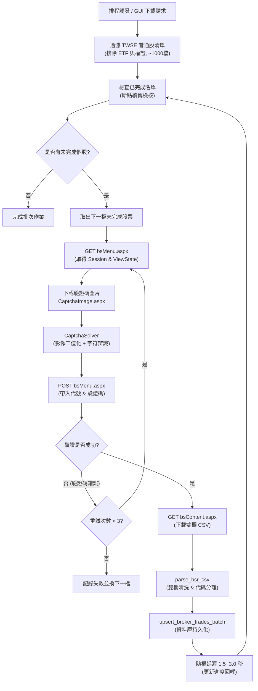

# Design: 集中市場當日交易資料（券商買賣分點日報表）自動化抓取與入庫

## 1. 系統架構總覽

本設計旨在為 `Taiwan_Stocks_Crawler` 提供對臺灣證券交易所（TWSE）「買賣日報表查詢系統」（`https://bsr.twse.com.tw/bshtm/`）的自動化擷取與持久化能力，包含全自動驗證碼辨識、斷點續傳流水線、雙欄 CSV 剖析、資料庫持久化儲存與 CLI / GPUI 介面整合。



---

## 2. 資料庫設計 (Migration V8)

### 2.1 資料表結構

```sql
-- 集中市場券商營業據點買賣日報表
CREATE TABLE IF NOT EXISTS broker_trades (
    trade_date       TEXT NOT NULL,
    symbol_clean     TEXT NOT NULL,
    broker_id        TEXT NOT NULL,
    broker_name      TEXT NOT NULL,
    price            REAL NOT NULL,
    buy_shares       INTEGER NOT NULL DEFAULT 0,
    sell_shares      INTEGER NOT NULL DEFAULT 0,
    PRIMARY KEY (trade_date, symbol_clean, broker_id, price)
);

-- 加速依個股與日期查詢分點成交明細
CREATE INDEX IF NOT EXISTS idx_broker_trades_symbol_date
    ON broker_trades(symbol_clean, trade_date);

-- 加速依券商分點與日期查詢主力進出紀錄
CREATE INDEX IF NOT EXISTS idx_broker_trades_broker_date
    ON broker_trades(broker_id, trade_date);
```

### 2.2 核心資料模型 (`stock-core::models`)

```rust
#[derive(Debug, Clone, Serialize, Deserialize, PartialEq)]
pub struct BrokerTradeRecord {
    pub trade_date: String,
    pub symbol: String,
    pub broker_id: String,
    pub broker_name: String,
    pub price: f64,
    pub buy_shares: i64,
    pub sell_shares: i64,
}

#[derive(Debug, Clone, Serialize, Deserialize)]
pub struct BrokerSummary {
    pub broker_id: String,
    pub broker_name: String,
    pub total_buy: i64,
    pub total_sell: i64,
    pub net_shares: i64,
}
```

---

## 3. 資料擷取與驗證碼處理模組 (`stock-core::fetcher::bsr`)

### 3.1 驗證碼辨識引擎 (`CaptchaSolver`)

BSR 驗證碼為 200×60 像素、固定 5 碼大寫英數字元，具有深灰色背景、雪花點狀雜訊與單條微弧貫穿線。
- **影像前處理階段**：
  1. **灰階化與直方圖二值化**：將像素亮度高於門檻值（例如 > 200）之文字主體標記為前景（白色），背景與淺色噪點設為背景（黑色）。
  2. **中值濾波與點狀降噪**：透過 3×3 鄰域濾波清除孤立的雪花單點雜訊。
  3. **字符定位分割**：BSR 字符排列規則，字符間距固定，可依 X 軸投影或固定切片（每字元寬約 35~40 像素）分割出 5 個子圖像。
- **字符辨識階段**：
  - 建立輕量字符特徵分類器（或內嵌小型 ONNX 模型），映射 5 碼大寫字元（`A-Z`, `0-9`，排除易混淆字）。
  - 當遇到模糊或切分重疊時，回傳置信度；若辨識失敗觸發伺服器驗證碼錯誤，由流水線自動換碼重試（最多 3 次）。

### 3.2 雙欄 CSV 解析器 (`parse_bsr_csv`)

真實 BSR 輸出檔案為左右並排格式：
- **跳過前 3 列**（檔頭中繼說明與列名）。
- **逐列解析**：
  - 左半部：第 0~4 欄為 `[序號, 券商, 價格, 買進股數, 賣出股數]`。
  - 右半部：第 6~10 欄為 `[序號, 券商, 價格, 買進股數, 賣出股數]`（第 5 欄為空分隔欄）。
- **券商代碼與名稱清洗**：
  - 券商前 4 碼為 `broker_id`（如 `1020`, `9B2Z`）。
  - 後半部字串去除半形與全形空白（`　`）提取為 `broker_name`。
- **無效列過濾**：
  - 右半部或左半部若序號為空字串，自動忽略該半側。

---

## 4. 批次流水線與斷點續傳 (`stock-core::pipeline::broker`)

### 4.1 普通股名單過濾
- 自 `securities` 表格提取所有符合下列條件之標的：
  - `market == "TWSE"`
  - `symbol.len() == 4` 且所有字元皆為數字（即 `1101` 至 `9958`）。
  - 嚴格過濾排除 `00` 開頭之 ETF 與各類 6 碼權證。

### 4.2 斷點續傳（Checkpointing）
- 在執行批次抓取時，先向資料庫查詢：
  ```sql
  SELECT DISTINCT symbol_clean FROM broker_trades WHERE trade_date = ?1;
  ```
- 比對目標股票清單，直接剔除當日已存在的代號，僅對尚未抓取之個股進行網路請求，確保重啟或斷線時不重複消耗配額。

### 4.3 隨機延遲與指數退避
- **隨機延遲 (Jitter)**：每完成一檔股票隨機休眠 1.5 ~ 3.0 秒。
- **異常冷卻 (Backoff)**：若遇到 HTTP 403 / 503 或連續 3 次連線失敗，自動暫停 30 秒後重新初始化 Session，保護 IP 不被長時間封鎖。

---

## 5. 介面與排程整合

### 5.1 CLI 子命令 (`stock-cli`)
```bash
# 下載指定日期之集中市場券商日報表
stock-cli fetch-broker --date 2026-10-08

# 下載指定單一股票
stock-cli fetch-broker --date 2026-10-08 --symbol 2330
```

### 5.2 GPUI 桌面端介面 (`stock-gpui`)
- 於「資料下載」分頁新增「集中市場券商買賣日報表」下載專區。
- 提供日期選取器、目標股票數（~1020 檔）、目前進度條（如 `452 / 1020`）、目前處理個股與取消/續傳按鈕。

---

## 6. 測試規劃

1. **解析器回歸測試**：
   - 使用真實 `docs/集中市場當日交易資料_2026-10-08_2330.csv` 樣例驗證 `parse_bsr_csv`，確保 4,431 筆成交記錄完整提取無漏。
2. **驗證碼辨識測試**：
   - 針對下載之驗證碼樣例圖片（如 `scratch/live_cap.png` 等）進行圖像前處理與字符提取測試。
3. **資料庫遷移與讀寫測試**：
   - 驗證 Migration V8 正確建立 `broker_trades` 表與索引。
   - 驗證 `upsert_broker_trades_batch` 具備重複寫入之冪等性。
4. **批次流水線整合測試**：
   - 驗證斷點續傳檢核正確略過已入庫股票。
   - 驗證取消信號可即時中斷流水線。
